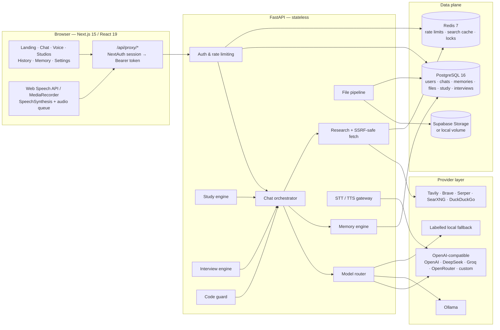
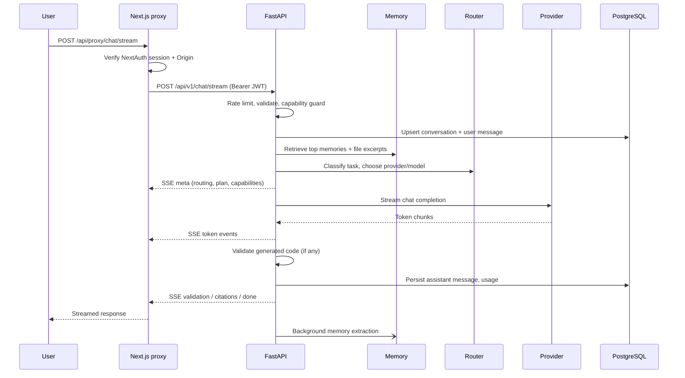
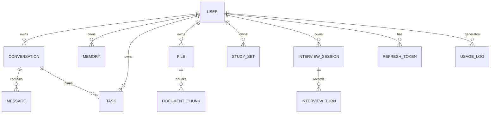

# AETHER — Architecture Blueprint

> **AETHER** — *Adaptive Engine for Thought, Help, Execution & Research*
> A voice-first, memory-aware AI workspace for study, code, interviews, research, files and everyday work.

This document is the source of truth for the system design. It is intentionally implementation-level: every box below maps to code in this repository.

---

## 1. Design principles

1. **Honest intelligence** — AETHER never pretends to perform an action it cannot perform. Capability guardrails detect impossible or unsafe requests and explain the limitation with a concrete alternative.
2. **Voice-first, text-native** — every capability is available in text; voice is a low-friction layer on top of the same streaming chat pipeline.
3. **Provider independence** — one `ChatProvider` contract supports OpenAI-compatible APIs (OpenRouter, OpenAI, DeepSeek, Groq, Together, Mistral, custom gateways), native Ollama, and a labelled local fallback. Configured providers are validated at startup and tried in model-priority order with automatic cross-provider fallback.
4. **Routing, not a single model** — lightweight models handle simple turns, coding models handle code, reasoning models handle architecture/interview work.
5. **Memory with provenance** — short-term context (rolling summary + recent turns) and long-term memory (facts, preferences, goals, projects) are separate, inspectable and deletable. Retrieval uses the current turn, the rolling summary, and pinned identity/preference memories.
6. **Secure by construction** — server-only secrets, JWT rotation, origin checks, rate limits, SSRF guards, upload validation, prompt-injection delimiting, strict CSP.
7. **Production defaults** — async I/O end to end, stateless API, Postgres/Redis, Docker, migrations, health checks, CI, structured logs.
8. **Local fallback only without a valid key** — the product remains explorable with no provider, but a valid key always wins. Placeholder or malformed provider configuration is skipped with a diagnostic; the fallback provider is not registered at all when a real provider is available.
9. **Execution-first conversation** - the assistant performs the task and leads with the result; plans and visible step-by-step reasoning are opt-in.

---

## 2. System topology



### Deployment topology

- **Web** — Cloudflare Workers via OpenNext (free plan) or the bundled Docker image. Cloudflare Pages is not used because `@cloudflare/next-on-pages` supports only Next.js ≤15.5.2; this app runs 15.5.29.
- **API** — Render Free (Docker web service, spins down after 15 minutes idle) or any container host. Stateless; scale horizontally when the host supports it.
- **PostgreSQL** — Supabase Free through the session pooler with TLS, or the Compose service. Alembic owns the schema.
- **Redis** — optional managed Redis (Upstash free, etc.) or the Compose service. The API degrades to an in-process limiter/cache if Redis is unavailable, with a startup warning.
- **Storage** — Supabase Storage in production (private `aether-files` bucket); a local volume for Compose development. Render Free and Cloudflare Workers have no persistent disk.
- **Auth** — Auth.js (NextAuth v5) on the web tier, with a Credentials provider backed by FastAPI and optional GitHub/Google OAuth. FastAPI issues short-lived access tokens and rotating refresh tokens.

The recommended free topology is **Cloudflare Workers + Render Free +
Supabase Free**; see [`DEPLOYMENT.md`](DEPLOYMENT.md).

---

## 3. Request flows

### 3.1 Chat (streaming)



SSE event contract:

| Event | Payload |
|---|---|
| `meta` | conversation/message ids, provider, model, tier, routing reason, plan, mode |
| `status` | human-readable progress (`researching`, `validating`, `repairing`) |
| `token` | `{ "text": "..." }` |
| `replace` | full corrected text (used after code repair) |
| `citations` | numbered sources with title/url/snippet |
| `validation` | language, ok flag, issues with severity/line/rule/suggestion |
| `usage` | input/output tokens, latency |
| `done` | final ids, conversation title, memory-update count |
| `error` | stable code + safe message |

### 3.2 Voice

```mermaid
sequenceDiagram
    participant U as User
    participant B as Browser
    participant A as FastAPI
    participant P as Provider

    U->>B: Speech
    B->>B: VAD / SpeechRecognition (interim + final)
    alt browser STT available
        B->>B: final transcript
    else backend STT
        B->>A: POST /voice/transcribe (webm/wav)
        A->>P: Whisper-compatible / Deepgram
        P-->>A: transcript
    end
    B->>A: POST /chat/stream
    A-->>B: token stream
    B->>B: sentence chunker + TTS queue
    alt provider TTS
        B->>A: POST /voice/synthesize
        A->>P: OpenAI TTS / ElevenLabs
        P-->>A: audio/mpeg
        A-->>B: audio bytes
    else browser TTS
        B->>B: speechSynthesis
    end
    B->>B: Barge-in on new speech; abort stream + audio
```

Continuous mode = VAD keeps listening after each turn; barge-in stops playback and the active generation.

### 3.3 Research with citations

1. Task classifier detects explicit web mode, research intent, or a current-information signal (news, releases, prices, versions). Code-editing requests are excluded from automatic search.
2. Search provider returns 5–8 results. With no dedicated search key, DuckDuckGo's HTML endpoint is the fallback.
3. Top pages are fetched through the SSRF-safe fetcher (public IPs only, redirect re-validation, 2 MB cap).
4. Main content is extracted, trimmed and wrapped in `<source>` delimiters marked **untrusted**.
5. The model is instructed to cite claims as `[n]`; the API emits a `citations` event.
6. Results are cached in Redis for 30 minutes.

### 3.4 Files

Upload → MIME/extension/magic validation → size cap (25 MB) → storage (Supabase or local) → text extraction (PDF, DOCX, XLSX, CSV, JSON, TXT/MD; images get vision/metadata) → paragraph-aware chunking → `document_chunks` → keyword-ranked retrieval into chat context or `/files/{id}/analyze`.

### 3.5 Memory

- **Short-term**: last 20 turns + rolling conversation summary, regenerated in the background when the transcript exceeds the context budget.
- **Long-term**: categories `identity`, `preference`, `goal`, `project`, `skill`, `relationship`, `schedule`, `fact`. Extracted by the fast model as strict JSON after a turn (regex fallback), deduplicated by normalized key, confidence-scored, editable by the user.
- **Retrieval**: lexical overlap against the current turn plus the rolling summary, with recency, confidence and category boosts. High-confidence identity/preference memories are pinned for continuity. Embeddings are used when the active provider supports them.
- **Preference memory**: explicit settings (response style, language, voice, routing strategy) are injected separately from inferred memories.

### 3.6 Code protocol

Every code request goes through `CodeGuard`:

1. Detect language (hint → fence tag → heuristics).
2. Syntax check (Python AST, JSON parser, SQL splitter; delimiter/string/comment scanner for C-family, JS/TS, Go, Rust, PHP, Dart, Kotlin, Swift, Ruby, Java, C#).
3. Placeholder detection (`TODO`, `...`, `your_api_key`, stub bodies).
4. Security scan (hardcoded secrets, injection sinks, unsafe deserialization, weak crypto, shell execution, disabled TLS verification, unsafe DOM APIs, buffer-unsafe C functions).
5. Logic/edge-case heuristics (empty input, pagination, auth, error handling) and performance warnings (nesting depth, long functions).
6. If the generated answer contains a code block with syntax errors, one repair round is attempted with the validation report; the final text is re-validated and streamed with a `replace` event.

This is a deterministic guard around probabilistic generation — the system reports what it actually checked rather than claiming perfect correctness.

---

## 4. Model routing

| Task class | Signals | Tier |
|---|---|---|
| `coding` | fenced code, debug/refactor/review, language/framework names, SQL, stack traces | `coding` |
| `reasoning` | proofs, architecture, trade-offs, system design, complex multi-step, long input | `reasoning` |
| `interview` | interview/mock/HR/DSA/company names | `reasoning` |
| `study` | notes, quiz, flashcards, explain, teach, exam, revision | `balanced` |
| `research` | web/search/latest/news/sources | `balanced` + web tool |
| `voice` | voice mode, short conversational turn | `fast` |
| `general` | greetings and small talk | `fast` |
| `general` | normal questions and requests | `balanced` |

Provider preference is configurable per deployment:

- `quality` (default): Claude Sonnet via OpenRouter → GPT-4.1 → Gemini via OpenRouter → DeepSeek V4.1 → Groq, then every other configured provider as a deeper fallback.
- `cost`: DeepSeek → Groq → OpenAI → OpenRouter → custom → Ollama.
- `local`: Ollama → DeepSeek → Groq → OpenAI → OpenRouter → custom.

`PROVIDER_PRIORITY` switches quality routing to explicit provider order. The
registry returns a ranked candidate list, and `app/ai/execution.py` walks it at
runtime: a provider error, timeout, rate limit or empty completion moves to the
next candidate. Streaming falls back only before the first text token; after
that the partial answer is kept. Each provider exposes its own tier→model map,
so routing is deterministic, observable (`meta` event) and testable.

Startup validation lives in `app/ai/provider_config.py`. It detects keys,
rejects empty/placeholder keys, validates absolute base URLs and non-empty model
IDs, and records every problem in the startup report. Invalid providers are
skipped; valid ones are registered. The fallback provider is constructed only
when no valid real provider exists, even if `DEMO_MODE=true`. The
`/api/v1/health/providers` endpoint returns the detected providers, selected
model per tier and validation issues, never key values. Explicit user mode
(`mode: "coding"`) overrides classification.

---

## 5. Data model



Key tables: `users`, `refresh_tokens`, `conversations`, `messages`, `memories`, `tasks`, `files`, `document_chunks`, `study_sets`, `interview_sessions`, `interview_turns`, `usage_logs`. Portable SQLAlchemy types (`String(36)` UUIDs, `JSON` with a JSONB variant on Postgres) keep SQLite usable for tests while production runs Postgres. Alembic owns production schema changes.

---

## 6. Security model

| Threat | Control |
|---|---|
| Credential theft | Argon2id hashing, generic login errors, login throttling, rotating hashed refresh tokens with reuse detection |
| Token leakage | Access token 15 min, refresh 30 days, HttpOnly/SameSite cookies on the web tier, bearer tokens never in browser storage |
| CSRF | SameSite cookies, Origin verification on every proxied mutation, Auth.js CSRF protection |
| XSS | React escaping, no raw HTML rendering, sanitized Markdown, strict CSP, output sanitization |
| SQL injection | SQLAlchemy parameterization, no string-built SQL |
| SSRF | scheme/host validation, DNS resolution against private/loopback/link-local ranges, manual redirect validation, response size caps |
| Prompt injection | retrieved content delimited and labeled untrusted; system prompt hierarchy; no tool execution from retrieved text |
| Malicious uploads | extension + MIME + magic-byte checks, 25 MB cap, filename sanitization, private storage, no execution |
| Secret exposure | keys only in backend env; `/models` exposes availability booleans, never values; `.env` ignored |
| Abuse | Redis sliding/fixed-window rate limits per IP and user, upload quotas, auth throttling |
| Clickjacking | `frame-ancestors 'none'` + `X-Frame-Options: DENY` |
| Data loss | account export, cascade deletion, refresh-token revocation, documented backup strategy |

Detailed threat notes and production checklist: [`SECURITY.md`](SECURITY.md).

---

## 7. Folder structure

```text
aether/
├── apps/
│   ├── api/
│   │   ├── app/
│   │   │   ├── main.py                  FastAPI app, lifespan, middleware
│   │   │   ├── core/                    config, DB, auth, rate limiting, logging, errors
│   │   │   ├── models/                  SQLAlchemy models
│   │   │   ├── schemas/                 Pydantic request/response contracts
│   │   │   ├── api/                     versioned routers
│   │   │   ├── ai/                      providers, provider_config, router, prompts, context, guards
│   │   │   ├── services/                chat, memory, files, search, voice, storage
│   │   │   └── utils/                   text, security, JSON parsing
│   │   ├── tests/                       unit + integration tests
│   │   ├── alembic/                     migrations
│   │   ├── pyproject.toml
│   │   └── Dockerfile
│   └── web/
│       ├── app/                         App Router pages + auth/proxy routes
│       ├── components/                  UI, landing, chat, voice, studios, settings
│       ├── hooks/                       chat stream, voice loop, recorder
│       ├── lib/                         API client, SSE, audio queue, utils
│       ├── stores/                      Zustand stores
│       ├── auth.ts                      Auth.js configuration
│       ├── package.json
│       └── Dockerfile
├── docs/                                architecture, API, deployment, security
├── deploy/                              Cloudflare, Render, Supabase deployment assets
├── infra/                               Railway, Vercel configs
├── scripts/                             env bootstrap, demo seed
├── docker-compose.yml
├── .env.example
├── .github/workflows/ci.yml
└── README.md
```

---

## 8. API surface (v1)

`/api/v1` — `auth`, `settings`, `models`, `conversations`, `chat`, `memories`, `tasks`, `files`, `study`, `interview`, `code`, `search`, `voice`, `health`.

Full request/response examples: [`API.md`](API.md).

---

## 9. Deliberate limits

AETHER is a web application, not an operating-system agent. It cannot place calls, send email from your account, control your device, make purchases, read private third-party accounts, or execute generated code. It can draft, explain, plan, analyze files, search public web pages, and write code for you to run. The capability guard states this explicitly instead of hallucinating success.

---

## 10. Build phases

1. **Blueprint** — this document, folder structure, contracts.
2. **Backend** — core, auth, database, migrations, rate limiting.
3. **AI systems** — providers, routing, context, memory, research, study, interview, code guard.
4. **Frontend** — design system, landing, app shell, chat, voice, studios, history, memory, settings.
5. **Voice** — browser loop, backend STT/TTS gateway, barge-in.
6. **Deployment** — Docker, Compose, Cloudflare Workers + Render + Supabase free stack, CI, docs, GitHub release.
